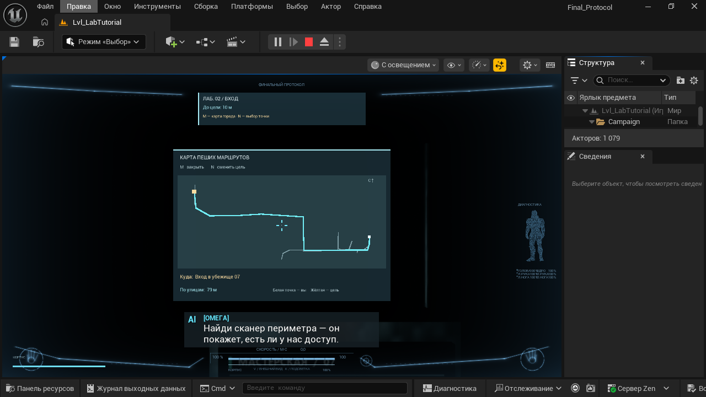
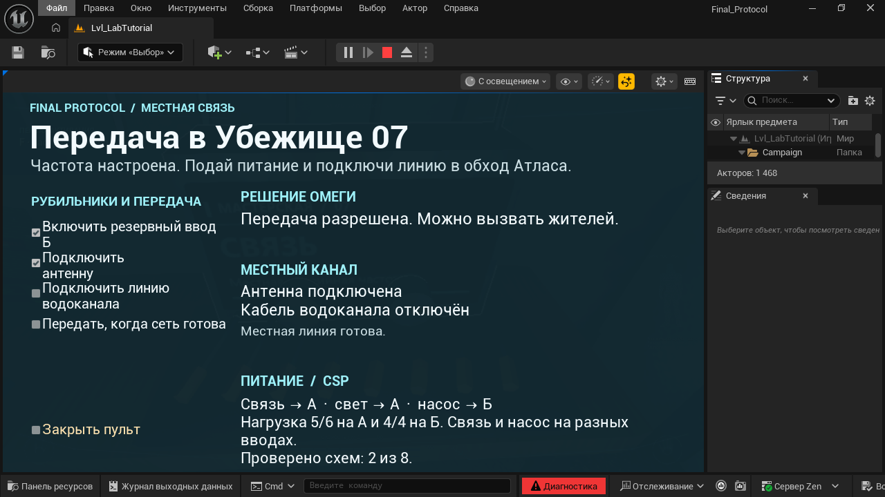

# Final Protocol

QAIRU AI Fundamentals Final Project 2026. Unreal Engine 5.8 негізінде жасалған Windows ойыны.

Сентинел зертханада оянып, қираған қаланы зерттейді. Ол аман қалған тұрғындарға көмектесу үшін жергілікті байланыс пен сумен жабдықтауды қалпына келтіреді. Негізгі идея — еркіндік және адамдардың өз өмірін басқару құқығы.

## Демо іске қосу

Windows демосының дайын архиві — `Final_Protocol_Demo_For_Friends.zip`. Компьютерге архивтің барлық мазмұнын шығарып, `Final_Protocol_Demo/Play_Campaign_720p.cmd` файлын ашыңыз. `Engine` және `Final_Protocol` бумалары іске қосу файлының қасында болуы керек. Негізгі мәзірден жаңа ойын немесе жалғастыруды таңдаңыз.

Басқару — WASD қозғалу, тінтуірмен қарау, экрандағы нұсқауға қарай E/F әрекет ету, Q қару ауыстыру, R оқтау, M карта, N картадағы мақсатты өзгерту.

## Үш AI тақырыбы

| Апта | Әдіс | Ойындағы қолданылуы | Негізгі код |
|---|---|---|---|
| 1 | Intelligent Agents and Environments | Омега жергілікті арна, қуат және эфирге сұрау күйіне қарай күтеді немесе хабар жібереді | `Content/Python/Install_StationNetwork.py`, `ResolveNetwork`, `SubmitBroadcast` |
| 2 | A* және эвристика | Картада ойыншыға мақсатқа апаратын ең қысқа жаяу бағытты табады | `Content/Python/Install_CityStreetGuide.py`, `install_search` |
| 3 | Constraint Satisfaction Problems | Байланыс, жарық және сорғыны екі қуат көзіне шектеулерге сай бөледі | `Content/Python/Install_OmegaDiagnostics.py`, `power` |

Станциядағы агент алдын ала жазылған ережелермен жұмыс істейді. Байланыс үшін 3, жарық үшін 2, сорғы үшін 4 жүктеме бірлігі қажет. А көзі 6, Б көзі 4 бірлікке есептелген. Байланыс пен сорғы бөлек көздерге қосылады. CSP үш құрылғының екі көзге тағайындалуының сегіз нұсқасын тексереді. Бұл бірліктер — оқу моделінің мәндері.

## Архитектура

Python авторлау скрипттері Unreal Editor ішінде Blueprint графтарын жасайды. Ойын іске қосылғанда алгоритмдер Blueprint-та орындалады. `Source/Final_Protocol` құрамында C++ модулі, жөндеу интерфейсі және негізгі мәзір коды бар. Қала графы 138 түйін мен 141 екіжақты қырдан тұрады. Координаттар Unreal сантиметрімен сақталады, экранда жол ұзындығы метрмен көрсетіледі.

## Кодты тексеру

Python 3.10 немесе жаңарақ нұсқада келесі пәрмендерді орындаңыз.

```sh
python evidence/city/CityWalkReference.py
python tools/verify_course_topics.py
```

Бірінші тексеру A* нәтижелерін Дейкстрамен графтың барлық 9591 жұбы үшін салыстырады. Екінші тексеру CSP және агент ережелерінің жеке эталондық модельдерін тексереді. Ойын ішіндегі Blueprint және PIE нәтижелері `evidence` ішінде сақталған.

## Ойыннан алынған дәлелдер





`evidence/city/StreetTests.json` — Blueprint-тағы он есептеу сценарийі. `StreetPIE.json` — карта ашылуы, мақсат ауыстыруы және қайта есептелуі. `evidence/station/MissionPIE.json` — станцияның жеті күйі және медик жауабына өту. `evidence/city/Windows.json` — дайын Windows жинағының іске қосылу нәтижесі.

## Unreal жобасын әзірлеу

Бұл репозиторий ойынның C++, Python бастапқы кодын, жоба сипаттамасын және тексеру дәлелдерін қамтиды. Blueprint авторлау скрипттері Unreal Engine 5.8 және бастапқы жобаның Content ресурстарын талап етеді. Толық ойынның орындалатын жинағы бөлек демо архивінде беріледі. FAB/Downtown West және басқа сыртқы модельдер өз лицензияларымен қолданылады, оларды бастапқы ресурс түрінде қайта таратуға бөлек құқық қажет. Осы код көшірмесінен толық Content кітапханасын автоматты қалпына келтіру қарастырылмаған.

## Белгілі шектеулер

Карта тек тексерілген көшелер желісін қамтиды. Қозғалатын кедергілер графты автоматты өзгертпейді. Жергілікті арна мен қуат моделі оқу мақсатында ықшамдалған. Есептеулер, PIE және жинақтың іске қосылуы тексерілген. Толық ойынды жаңа ойыншының көмексіз өтуі бөлек тексеруді қажет етеді.

## Команда және қорғау рөлдері

| Қатысушы | Қорғаудағы бөлімі |
|---|---|
| Өмірәлі Нұрдәулет | 1–4 беттер, идея, әлем және кейіпкерлер |
| Нурдулла Нұрасыл | 5–6 беттер, әзірлеу және жөндеу механикалары |
| Мұзаппар Нұрислам | 7–8 беттер, A* және CSP |
| Орынбасар Дулат | 9–11 беттер, Омега және тексеру |
| Кемербаева Еркежан | 12–15 беттер, нәтиже және оқиғаның соңы |

Бұл кесте автор бекіткен қорғау рөлдерін көрсетеді. Әр қатысушының жеке бағдарламалау үлесі бөлек расталуы тиіс.

## AI қолдану туралы мәлімдеме

Жобаны әзірлеуде Codex/ChatGPT идеяларды талдау, Python/C++ коды, Blueprint авторлау, диагностика және құжаттама дайындауға қолданылды. Кейбір көрнекі тұжырымдамалар Gemini арқылы жасалды. Қорытынды тексеру және жұмысты түсіндіру командаға тиесілі. `evidence` тек нақты орындалған тексерулерді көрсетеді.

## Дереккөздер

- QAIRU AI Fundamentals Final Project 2026 тапсырмасы.
- Unreal Engine 5.8 жергілікті қозғалтқыш коды және Blueprint API.
- Қала графының бастапқы жүріп өту жазбалары `evidence/city/CityWalkSources.json` ішінде көрсетілген.
- Сыртқы модельдер мен материалдар жобалық лицензияларына сәйкес қолданылған.


## Қорғау материалдары

[Техникалық есеп, ЖИ декларациясы, үлес формасы және қорғау сценарийі](submission/README.md). Жеке үлес формасы мен бес адамдық құрамды келісу команда тарапынан растауды күтеді.
